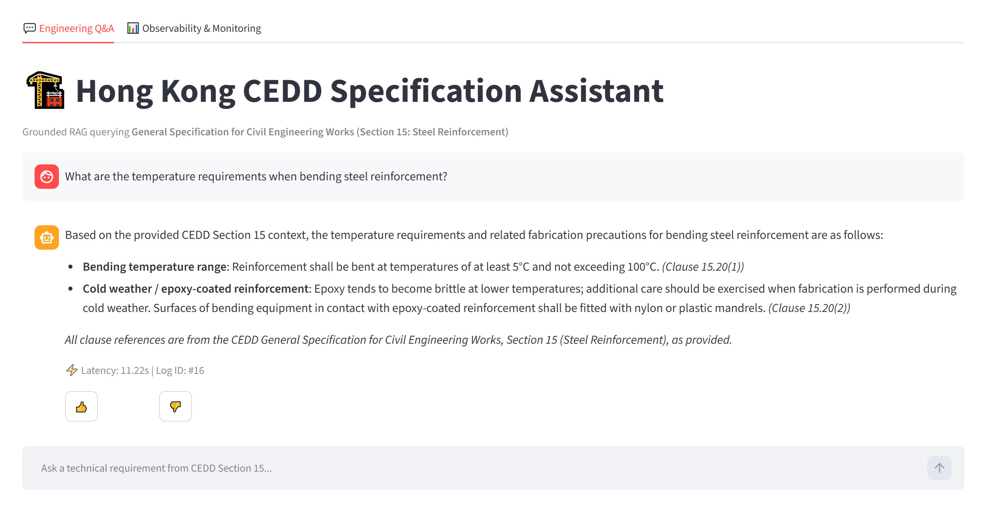
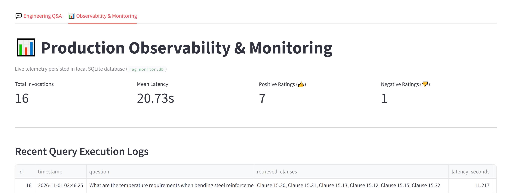

# Hong Kong CEDD Specification Assistant 🏗️

An AI-powered search and chat assistant designed to instantly find and explain technical requirements from the **Hong Kong Civil Engineering and Development Department (CEDD) General Specification**.

* **Focused Domain Scope:** Implemented using **Section 15 (Steel Reinforcement)** as the pilot technical dataset. The ingestion and chunking architecture is modular, allowing additional specification sections to be indexed simply by placing their source documents into `data/`.

---

## 📖 What Does This App Do?

Imagine having to search through a massive legal and technical engineering specification to find out exactly what temperature steel reinforcement needs to be bent at, or what particulars need to be submitted for approval. 

Normally, an engineer would have to `Ctrl+F` through a massive PDF, hoping they guess the exact right keyword. 

**This application solves that problem by using AI:**
1. **You ask a question in plain English** (e.g., *"How do I store steel on site?"*).
2. **The AI instantly reads the CEDD Specification** and finds the exact relevant clauses.
3. **It generates a simple, accurate answer** and provides the exact Clause Number (e.g., *Clause 15.19*) so you can verify the information yourself. 
4. It never guesses or "hallucinates" answers—if the Specification doesn't mention it, the AI will honestly tell you it doesn't know.

### 📸 App Screenshots

**1. Engineering Chat Assistant**

>  

**2. Observability & Monitoring Dashboard**

> 

---

## 👨‍💻 Technical Overview (For Developers)

This project is a Retrieval-Augmented Generation (RAG) application. It acts as a bridge between the CEDD Specification and the AI, ensuring the AI only answers using the official text.

🎓 *Built with reference to principles and architectures taught in the [DataTalksClub LLM Zoomcamp](https://github.com/DataTalksClub/llm-zoomcamp).*

### 🌟 Key Features

* **Hybrid Search:** It combines two different search methods to get the most accurate results:
  * **Keyword Search (`BM25`):** Great for finding exact text, like specific clause numbers (e.g., "15.20") or steel grades.
  * **Meaning-Based Search (`ChromaDB`):** Uses an AI embedding model to understand the *meaning* of a question, so it can find the right rule even if the user uses different words than the document.
* **Smart PDF Chunking:** Instead of splitting the PDF into random blocks of text, the code carefully breaks the document apart clause-by-clause. This prevents important rules from being chopped in half across pages.
* **Built-in Monitoring:** Automatically saves all user queries, the AI's answers, response times, and user feedback (👍/👎) into a local SQLite database.
* **Accuracy Testing:** Includes an automated test to measure how often the search engine successfully finds the correct clause, proving it works with hard numbers.

### 📊 Evaluation Benchmarks (@k=4)

* **Hit Rate:** 100.00% (The correct clause was found in the top 4 search results for 7/7 test questions)
* **MRR:** 0.8571 (The correct clause was almost always the #1 or #2 result)

### 🛠️ Tech Stack

* **Framework:** LangChain
* **Database (Vector Store):** ChromaDB (Local)
* **Embeddings:** HuggingFace `sentence-transformers/all-MiniLM-L6-v2` (Runs locally on CPU)
* **LLM Engine:** OpenRouter API (`nvidia/nemotron-3.5-lightning:free`)
* **Frontend UI:** Streamlit
* **Monitoring:** SQLite + Pandas

---

## 🚀 Setup Instructions (For Developers)

Follow these steps to run the RAG application locally or in a Codespace.

### 1. Clone & Install Dependencies

```bash
git clone https://github.com/danielxycai/cedd-spec-rag.git
cd cedd-spec-rag

# (Optional) Create a virtual environment
python -m venv .venv
source .venv/bin/activate  # On Windows use `.venv\Scripts\activate`

# Install required packages
pip install -r requirements.txt
```

### 2. Configure API Key

This project uses OpenRouter to access free, fast LLMs. 
1. Get a free API key from [OpenRouter](https://openrouter.ai/keys).
2. Create a `.env` file in the project root folder.
3. Add your key:
```env
OPENROUTER_API_KEY=sk-or-v1-your_api_key_here
```

### 3. Place Data & Run Offline Indexing

Ensure the CEDD Section 15 PDF is located at `data/section_15_steel_reinforcement.pdf`. Run the indexer to chunk the PDF and build the persistent ChromaDB vector store:

```bash
python -m src.indexer
```

### 4. Run Quantitative Evaluation (Optional)

Test the retrieval engine's accuracy against the ground-truth dataset:

```bash
python -m eval.evaluate
```

### 5. Launch the Web Application

Start the Streamlit UI:

```bash
streamlit run app.py
```
*The app will be available in your browser at `http://localhost:8501`.*